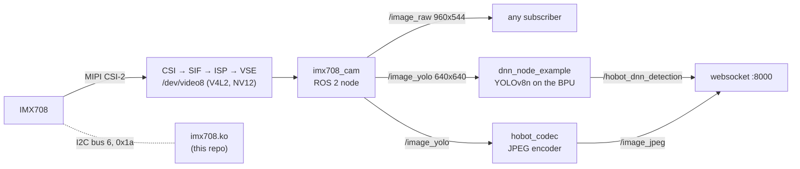
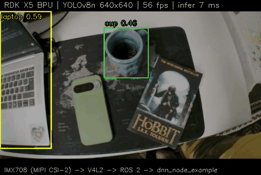

# IMX708 camera + YOLO on the RDK X5

D-Robotics **Dream Keeper Challenge 2026 Winter**, Stage 1:
board bring-up, a camera sensor the RDK X5 does not support out of the box,
and real-time YOLO object detection on the board's BPU.

- **Board:** RDK X5 (8x Cortex-A55, 10 TOPS BPU), RDK OS 3.5.0
  (Ubuntu 22.04.5, kernel 6.1.83, TogetheROS Humble)
- **Sensor:** Arducam IMX708 12 MP camera (Raspberry Pi Camera Module 3 sensor,
  wide-angle lens) on the CAM0 port
- **Interfaces:** video over **MIPI CSI-2** (2 lanes), sensor control over
  **I2C** (bus 6, controller `341d0000.i2c`, address `0x1a`); to Linux it is a
  **V4L2** device (`/dev/video8`), to ROS 2 a topic (`/image_raw`)

| What | Result (measured on the board) |
|------|--------------------------------|
| Camera | 1920x1080 sensor mode, scaled in hardware, **56 fps** NV12 into ROS 2 |
| YOLO | YOLOv8n 640x640 on the BPU: **6-7 ms** inference, **56 detections/s** (every frame), 18 ms from frame to result, BPU load 21 % |
| View | JPEG (hardware encoder) + boxes in the browser at `http://<board-ip>:8000` |
| Load | ~25 % of the 8 CPU cores for the whole pipeline |

## How it works



1. **Driver** ([driver/](driver/)): the Raspberry Pi kernel driver `imx708.c`
   ported to the X5 camera pipeline (one 1920x1080 mode, 56 fps), a device
   tree overlay for CAM0, and the X5 ISP files (borrowed from the IMX477).
   The board runs its camera pipeline in V4L2 mode
   (sensor → CSI → SIF → ISP → VSE); the vendor daemon `cam-service` drives the ISP.
2. **Camera node** ([ros/imx708_cam_node.py](ros/imx708_cam_node.py)): reads
   NV12 frames from `/dev/video8` with plain V4L2 memory-mapped streaming and
   publishes `sensor_msgs/Image` (`nv12`). It can also publish a letterboxed
   640x640 copy (`/image_yolo`, aspect ratio kept, black bars) for the detector.
3. **YOLO launch** ([ros/imx708_yolo.launch.py](ros/imx708_yolo.launch.py)):
   the camera node + the TogetheROS `dnn_node_example` (YOLOv8n, BPU) +
   `hobot_codec` (hardware JPEG) + `websocket` (web view).

Why the 640x640 topic: `dnn_node_example` resizes NV12 input that is not
already the model size with the VSE through the HBN camera stack, which is not
loaded in V4L2 mode (`Resize nv12 img fail!`). With a 640x640 input it skips
that resize, and the boxes (in 640x640 pixels) line up with the image shown
in the browser.

## Stage 1 evidence

| # | Deliverable | Evidence |
|---|-------------|----------|
| 1 | Flash + SSH | [flash with `dd`](docs/stage1/01-flash.png), [boot, Wi-Fi, internet, SSH session](docs/stage1/02-ssh.png) |
| 2 | Sensor: IMX708 camera over **MIPI CSI-2** (video) + **I2C** (control), as **V4L2** `/dev/video8` and **ROS 2** node `/imx708_cam` | [sensor on I2C bus 6](docs/stage1/03-camera-i2c.png), [driver + V4L2 + ROS 2 log, 56 fps](docs/stage1/04-sensor.log), [camera frame from `/image_raw`](docs/stage1/04-camera-frame.jpg) |
| 3 | AI task: YOLOv8n object detection on the **BPU** | [browser view with boxes](docs/stage1/05-yolo-browser.png), [annotated frame](docs/stage1/05-yolo-detections.jpg), [animation](docs/stage1/05-yolo-demo.gif), [log: 56 detections/s, BPU timing](docs/stage1/05-yolo.log) |
| 4 | GitHub repository | this README (setup, commands, dependencies, troubleshooting) |



The I2C scan (`0x1a` IMX708, `0x0c` focus motor, `0x50`/`0x58` EEPROM) was
taken before the driver was set up. Do not repeat it on a running system: see
[Troubleshooting](#the-camera-delivers-no-frames-stuck-i2c-bus). Serial-like
strings (a disk volume serial, a network profile UUID) are greyed out in the
screenshots.

## Setup

Everything below runs **on the board** unless noted.

### 1. Flash, boot, network

```bash
# on a Linux PC; check the device name with lsblk first, dd overwrites it
sudo dd if=rdk-x5-ubuntu22-preinstalled-desktop-3.5.0-arm64.img of=/dev/mmcblk0 \
        bs=4M status=progress conv=fsync
```

Boot the board (user `sunrise`, password `sunrise`), join Wi-Fi with
`sudo nmcli device wifi connect "<ssid>" password "<password>"`,
then work over SSH: `ssh sunrise@<board-ip>`.

### 2. Connect the camera

With the board powered off, plug the camera ribbon into **CAM0**.

### 3. Install the driver

```bash
git clone https://github.com/Spnh2000/rdk-x5-dreamkeeper.git ~/rdk-x5-dreamkeeper
cd ~/rdk-x5-dreamkeeper
sudo scripts/install_driver.sh
```

The script builds and installs the kernel module, the device tree overlay,
the ISP helper library and tuning, and writes `/boot/config.txt` (V4L2 camera
mode + overlay, old file backed up). The first run also prepares the kernel
header tree (about 2 minutes). Details: [driver/README.md](driver/README.md).

Then **power-cycle** the board (a soft reboot does not reset the sensor):

```bash
sudo systemctl stop cam-service; sync; sudo poweroff
# wait ~15 s, unplug the power for ~10 s, plug it back in
```

### 4. Check the sensor

```bash
lsmod | grep imx708
sudo dmesg | grep -E "imx708 6-001a: (chip|camera)"
#   imx708 6-001a: chip id try 0: ret 0 val 0x708
#   imx708 6-001a: camera module ID 0x0301
v4l2-ctl -d /dev/video8 --list-formats-ext     # NV12, 64x64 .. 1920x1080 (only while the camera is idle)
systemctl is-active cam-service                # must be active
```

### 5. Run

```bash
source /opt/tros/humble/setup.bash

# camera + YOLO + web view, then open http://<board-ip>:8000
ros2 launch ~/rdk-x5-dreamkeeper/ros/imx708_yolo.launch.py

# camera only (web view without detection)
ros2 launch ~/rdk-x5-dreamkeeper/ros/imx708_yolo.launch.py yolo:=false

# another detector from dnn_node_example's config/ folder
ros2 launch ~/rdk-x5-dreamkeeper/ros/imx708_yolo.launch.py config:=yolov11workconfig.json

# just the camera node
python3 ~/rdk-x5-dreamkeeper/ros/imx708_cam_node.py
```

Stop with Ctrl-C. For a launch running in the background or in another
session: `~/rdk-x5-dreamkeeper/scripts/stop_yolo.sh` (add `--nginx` to also
stop the web server).

### 6. Look at the results

```bash
source /opt/tros/humble/setup.bash
ros2 node list                                   # /imx708_cam /dnn_example /websocket /hobot_codec_...
ros2 topic hz /image_yolo                        # ~56
ros2 topic hz /hobot_dnn_detection               # ~56
ros2 topic echo /hobot_dnn_detection --once      # targets: type, rect, confidence + timing (perfs)
sudo hrut_somstatus                              # temperatures, clocks, BPU load ("ratio" column)
```

## Reference

### Launch arguments (`imx708_yolo.launch.py`)

| Argument | Default | Meaning |
|----------|---------|---------|
| `yolo` | `true` | run YOLO; `false` = camera + web view only |
| `config` | `yolov8workconfig.json` | file in `/opt/tros/humble/lib/dnn_node_example/config/` (also `yolov11workconfig.json`, `yolov5workconfig.json`, ...) |
| `width`, `height` | `960`, `544` | size of `/image_raw` |

### Camera node parameters (`imx708_cam_node.py`)

| Parameter | Default | Meaning |
|-----------|---------|---------|
| `device` | `/dev/video8` | V4L2 capture device (the VSE output) |
| `width`, `height` | `960`, `544` | any even size from 64x64 to 1920x1080; the VSE scales in hardware |
| `topic` | `/image_raw` | full image |
| `yolo_topic` | `""` (off) | letterboxed square copy; the launch file sets `/image_yolo` |
| `yolo_size` | `640` | side of the square, = the model input size |
| `frame_id` | `camera` | header frame id |
| `log_fps` | `true` | log the camera frame rate every 5 s |

A topic is only filled while something subscribes to it; both carry the
same time stamp for a given frame.

### Topics

| Topic | Type | Content |
|-------|------|---------|
| `/image_raw` | `sensor_msgs/Image` | `nv12`, 960x544 |
| `/image_yolo` | `sensor_msgs/Image` | `nv12`, 640x640, picture 640x362 at y=138 |
| `/image_jpeg` | `sensor_msgs/CompressedImage` | JPEG of `/image_yolo` (of `/image_raw` with `yolo:=false`) |
| `/hobot_dnn_detection` | `ai_msgs/PerceptionTargets` | boxes in `/image_yolo` pixels, class, confidence, timing |

## Dependencies

All are part of the RDK OS 3.5.0 desktop image:

- TogetheROS Humble (`/opt/tros/humble`): `dnn_node_example` 2.6.1,
  `hobot_codec` 2.3.5, `websocket` 2.3.2 (tested versions)
- YOLO models in `/opt/hobot/model/x5/basic/` (`yolov8_640x640_nv12.bin`)
- Python 3.10 with `rclpy`, `numpy`, `cv2` (OpenCV)
- `cam-service` (vendor camera daemon, enabled by default)
- For the driver build: `hobot-kernel-headers`, `gcc`/`make`, `dtc`
  (`sudo apt install hobot-kernel-headers build-essential device-tree-compiler` if missing)
- `v4l-utils` for `v4l2-ctl` (checks only)

## Troubleshooting

### The camera delivers no frames (stuck I2C bus)

Symptoms: the camera node logs `no frame from camera within 10.0 s`, and
`sudo dmesg | grep -E "imx708|341d0000"` shows
`i2c_designware 341d0000.i2c: controller timed out`, `chip id ... ret -5` or
`imx708 6-001a: Failed to write reg 0x0100`.

The sensor holds its I2C bus. **Only a power cut clears it**, a `reboot` does
not, re-binding the driver does not:

```bash
sudo systemctl stop cam-service; sync; sudo poweroff
# wait ~15 s, unplug the power for ~10 s, plug it back in
```

What triggers it, so avoid:

- user-space access to bus 6 while the driver owns the sensor
  (`i2cdetect` on bus 6, `i2cget`, ...)
- the TogetheROS `mipi_cam` node (below)
- soft reboots with the camera in use: restart with the power cycle above

Never unbind the I2C controller `341d0000.i2c`: that hung the kernel.

If the kernel log shows **no** I2C errors, another program probably opened
`/dev/video8` while the node was streaming. Even `v4l2-ctl -d /dev/video8 --info`
does it: when it closes the device the pipeline resets (`vs-sif ... sif0 reset
done`) and the stream stops. Run `v4l2-ctl` only while the camera is idle, then
restart the node.

### `mipi_cam` / `hobot_usb_cam` do not work

`mipi_cam` uses the HBN camera stack, which is not loaded in V4L2 mode, and
only knows the vendor's sensors (`There are no available host`); it can also
leave the I2C bus stuck. `hobot_usb_cam` only takes MJPEG/YUYV/UYVY, while
`/dev/video8` delivers NV12. Use `imx708_cam_node.py` instead.

### `Resize nv12 img fail!` / `Can't open vse src fd /dev/vs-vse0_src`

`dnn_node_example` got an image that is not the model input size and tried to
resize it with the VSE through HBN. Feed it `/image_yolo` (640x640), as
`imx708_yolo.launch.py` does.

### Boxes do not match the picture in the browser

The detections are in pixels of the image YOLO saw. The launch file encodes
`/image_yolo` for the browser for that reason; if you change topics, keep the
web view on the same image as the detector.

### Nodes keep running after stopping the launch

Run `scripts/stop_yolo.sh`. Do not stop `ros2 launch` with SIGTERM
(`kill <pid>`): it then exits at once and leaves its nodes running. The
`nginx` web server on port 8000 stays up on purpose; the next launch reuses
it (`stop_yolo.sh --nginx` stops it).

### Other notes

- `sif frame size incorrect` kernel lines at stream start/stop are harmless.
- `cam-service` must be running for `/dev/video8` to deliver frames.
- OpenCV's `cv2.VideoCapture(8, cv2.CAP_V4L2)` gives BGR frames but cannot
  deliver raw NV12 (with `CAP_PROP_CONVERT_RGB=0` the read fails), hence the
  plain V4L2 code in the node.
- In rclpy, assign image data as `array.array('B', ...)`: plain `bytes` are
  checked element by element (1.5 fps instead of 56).
- A rebuilt driver only loads after a restart (the pipeline holds the module).
- Colours are plausible but not calibrated (the ISP tuning is the IMX477's).
  Autofocus is not driven; the lens stays at its rest focus.

## License and credits

GPL-2.0 (see [LICENSE](LICENSE)). The driver is derived from the Raspberry Pi
Linux `imx708.c` (Copyright (C) 2022 Raspberry Pi Ltd, GPL-2.0); the overlay
is modelled on D-Robotics' IMX477 overlay. YOLO inference, JPEG encoding and
the web view are D-Robotics TogetheROS packages.
