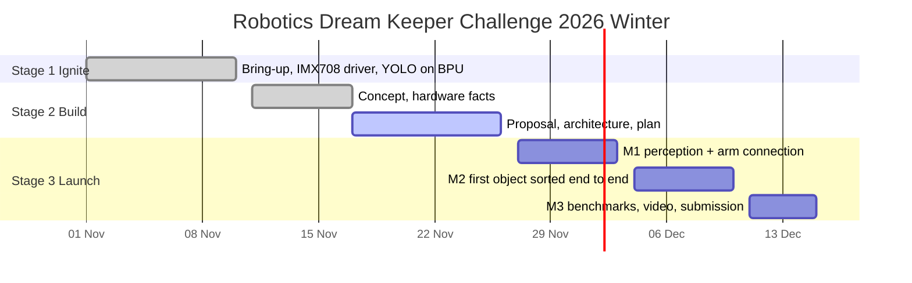

# Roadmap: Vision-Guided Desk Sorter

From a working camera + YOLO pipeline on the RDK X5 (Stage 1) to a Fairino
FR5 arm that sorts desk objects into bins (Stage 3 final demo, 15 December
2026). Plan details: [docs/stage2/](docs/stage2/).

## Milestones

### Stage 1 (1–10 Nov) — done
- [x] Board bring-up: RDK OS 3.5.0, Wi-Fi, SSH
- [x] IMX708 kernel driver ported to the RDK X5 (MIPI CSI-2 + I2C, 56 fps)
- [x] ROS 2 camera node, letterboxed 640x640 input for the BPU
- [x] YOLOv8n on the BPU: 56 detections/s, 7 ms inference, 21 % BPU load

### Stage 2 (11–26 Nov) — design
- [x] Concept: FR5 + Jodell EPG40-050 + wrist camera, desk sorting into 3 bins
- [x] Hardware facts verified on site; RDK X5 and camera mounted on the arm
- [x] [Proposal](docs/stage2/PROPOSAL.md)
- [x] [Architecture](docs/stage2/ARCHITECTURE.md)
- [x] [Engineering plan](docs/stage2/ENGINEERING_PLAN.md): BOM, schedule, risks, repository structure
- [ ] Showcase PR and community post

### M1: perception + arm connection (27 Nov – 3 Dec)
- [ ] YOLOv8n-seg on the BPU at ≥ 30 fps with masks (or the fallback from risk 2)
- [ ] Tracker node, custom messages (`sorter_msgs`), mock arm
- [ ] Arm session A1: Fairino SDK on the RDK X5: read state, slow linear move, gripper open/close
- [ ] Arm session A2: record survey images of the table for offline tests
- [ ] Repository restructured into `src/`, `launch/`, `config/`, `tests/`

### M2: first object sorted end to end (4–10 Dec)
- [ ] Localizer, sorter state machine, safety supervisor, control page
- [ ] Arm session A3: lens and hand-eye calibration
- [ ] Arm session A4: position accuracy test (target ≤ 10 mm)
- [ ] Arm session A5: first complete pick and place into the right bin

### M3: final demo and submission (11–15 Dec)
- [ ] Arm session A6: 20-object runs; benchmark table (fps, latency, accuracy, success rate)
- [ ] Arm session A7: demo video (3–7 min, ≥ 30 s continuous AI operation)
- [ ] Technical documentation: interfaces, calibration, safety, known issues, recovery
- [ ] Final showcase PR and community post (by 15 Dec)

## Success targets (from the proposal)

| Metric | Target |
|--------|--------|
| Detection / segmentation rate on the BPU | ≥ 30 fps |
| Image-to-arm-command latency | ≤ 100 ms |
| Grasp position error | ≤ 10 mm |
| Objects sorted into the correct bin | ≥ 80 % of 20 |
| Cycle time per object | ≤ 20 s |
