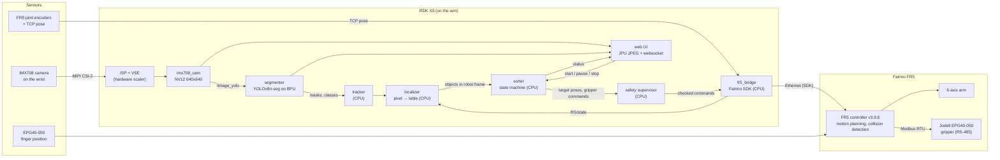
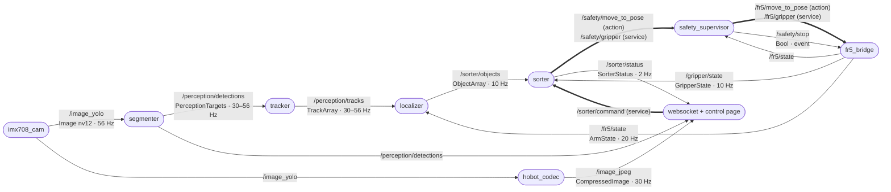

# Architecture: Vision-Guided Desk Sorter

**Stage 2 (Build), Challenge 2.** Companion documents: [PROPOSAL.md](PROPOSAL.md),
[ENGINEERING_PLAN.md](ENGINEERING_PLAN.md), [../../ROADMAP.md](../../ROADMAP.md).

The RDK X5 is the robot's **eyes and brain**: it runs the camera, the AI
models and all decisions. The Fairino FR5 controller is the **muscle**: it
plans and executes every motion and drives the gripper. The two talk over
Ethernet through Fairino's official SDK.

## 1. Data flow: sensors → AI → decision → actuators

**One sorting cycle in this flow:**

1. The sorter sends the arm to the **survey pose**. Once the arm reports
   it has stopped, the segmenter's masks are tracked over a few frames for
   stable positions.
2. The localizer turns each object's mask centre into a position on the
   table, using the camera calibration, the wrist pose at the time the
   image was taken, and the table height. It also gives each object's angle
   and width from the mask.
3. The sorter picks the nearest graspable object and moves the camera
   **above it** for a close-up re-detection, which corrects the position.
4. The gripper rotates to the object's angle, descends, closes, checks the
   finger position, lifts, moves to the object's bin, opens, and returns.

## 2. Modules

| Module | Runs on | Inputs | Outputs | Rate | Failure modes → handling |
|--------|---------|--------|---------|------|--------------------------|
| **IMX708 driver + cam-service** (Stage 1) | kernel, ISP, VSE | sensor over MIPI CSI-2; control over I2C | NV12 frames on `/dev/video8` | 56 fps | sensor holds I2C bus → stream stops; documented power-cycle recovery. A second program opening `/dev/video8` stops the stream → only the camera node opens it |
| **imx708_cam** (Stage 1) | CPU, 1 core | `/dev/video8` | `/image_yolo` (640x640), `/image_raw` (960x544) | 56 fps (configurable) | no frame for 2 s → node exits with an error; the sorter pauses and the web UI shows "camera lost" |
| **segmenter** | **BPU** + CPU post-processing | `/image_yolo` | `/perception/detections`: class, box, mask, confidence | 30–56 Hz | model or BPU error → node restarts; stale results (time stamp too old) are ignored by the tracker |
| **tracker** | CPU | detections | `/perception/tracks`: stable IDs, smoothed masks | same as detections | object lost for > 0.5 s → track dropped; flickering class → majority vote over the track |
| **localizer** | CPU | tracks, `/fr5/state`, calibration files | `/sorter/objects`: class, position (x, y), angle, width in the robot base frame | 10 Hz | arm moving while the image was taken → measurement discarded; object outside the table area or wider than 38 mm → marked "not graspable" |
| **sorter** | CPU | objects, arm and gripper state, UI commands | move and gripper requests, `/sorter/status` | event-driven, 2 Hz status | grasp failed (fingers fully closed) → one retry, then skip; object vanished during approach → back to survey; any error → pause and go to the safe pose |
| **safety supervisor** | CPU | every move request, `/fr5/state`, heartbeat | approved requests, `/safety/stop` | per request; 10 Hz heartbeat | target outside the workspace box, below the table height or faster than 250 mm/s → request rejected; heartbeat lost or controller error → stop the arm |
| **fr5_bridge** | CPU | approved requests | `/fr5/state`, `/gripper/state`, action and service results | 20 Hz state | network loss or SDK error → stop command, state "error", reconnect; the controller's own collision detection and e-stop act independently of the RDK X5 |
| **web UI** | JPU (JPEG), CPU | `/image_yolo`, detections, status | live view with masks, start/pause/stop, run log | 30 fps view | browser disconnect has no effect on the robot; the hardware e-stop is always the final stop |
| **FR5 controller** (vendor) | arm controller | target poses, gripper commands | motion, gripper action, state | internal | collision → controller stops the arm; e-stop pressed → power to motors cut |

## 3. Compute allocation

| Resource | Work assigned | Budget | Basis |
|----------|---------------|--------|-------|
| **BPU** (10 TOPS) | YOLOv8n-seg instance segmentation, 640x640 NV12 | ≤ 30 ms per frame, ≥ 30 fps, ≤ 60 % load | Stage 1 measured YOLOv8n detection at 7 ms, 56 fps, 21 % BPU load; segmentation adds the mask head, so the budget allows about 4x that |
| **ISP + VSE** (hardware) | demosaic, exposure, scaling 1920x1080 → 960x544 | 0 % CPU | Stage 1 |
| **JPU** (hardware) | JPEG for the web view | 0 % CPU | Stage 1: 56 fps |
| **CPU** (8x Cortex-A55) | camera node ~0.8 core; segmentation post-processing (mask decoding) ~0.5 core; tracker, localizer, sorter, supervisor, bridge, web together < 0.5 core | ≤ 2 of 8 cores | Stage 1 measured about 25 % of the CPU for camera + detection + JPEG + web |
| **FR5 controller** | inverse kinematics, motion planning, speed limits, collision detection, gripper Modbus | vendor | the RDK X5 never computes joint trajectories |
| **Off-board** | none | – | a laptop only opens the web page and is used for development; the robot works without it |

Why no off-board service: all models fit on the BPU with headroom; keeping
everything on the arm avoids network latency in the control loop and keeps
the system self-contained.

**Two concurrent workloads** (Stage 3 requirement): BPU segmentation of every
frame + CPU tracking and localisation of all objects, while the web UI streams
the annotated view.

## 4. ROS 2 node graph

Thin arrows are topics, thick arrows are services and actions. The sorter
never talks to the arm directly: every command passes the safety supervisor.

### Topics

| Topic | Type | Publisher → subscribers | Rate |
|-------|------|-------------------------|------|
| `/image_yolo` | `sensor_msgs/Image` (nv12, 640x640) | imx708_cam → segmenter, hobot_codec | 56 Hz |
| `/image_raw` | `sensor_msgs/Image` (nv12, 960x544) | imx708_cam → debugging tools | 56 Hz, only when subscribed |
| `/perception/detections` | `ai_msgs/PerceptionTargets` (boxes, masks, classes) | segmenter → tracker, web | 30–56 Hz |
| `/perception/tracks` | `sorter_msgs/TrackArray` | tracker → localizer | 30–56 Hz |
| `/fr5/state` | `sorter_msgs/ArmState` (joints, TCP pose, moving flag, error code) | fr5_bridge → localizer, supervisor, sorter | 20 Hz |
| `/gripper/state` | `sorter_msgs/GripperState` (position, holding flag, fault) | fr5_bridge → sorter | 10 Hz |
| `/sorter/objects` | `sorter_msgs/ObjectArray` (class, x, y, angle, width, graspable) | localizer → sorter | 10 Hz |
| `/sorter/status` | `sorter_msgs/SorterStatus` (state, current object, counts, last error) | sorter → web | 2 Hz |
| `/safety/stop` | `std_msgs/Bool` | supervisor → fr5_bridge | on event |
| `/image_jpeg` | `sensor_msgs/CompressedImage` | hobot_codec → websocket | 30 Hz |
| `/tf` | `tf2_msgs/TFMessage` (base → flange → camera) | fr5_bridge, static calibration | 20 Hz |

### Services and actions

| Name | Kind | Type | Server ← client | Purpose |
|------|------|------|-----------------|---------|
| `/safety/move_to_pose`, `/fr5/move_to_pose` | action | `sorter_msgs/action/MoveToPose` (goal: pose, linear/joint, speed; feedback: distance left; result: success, error code) | supervisor ← sorter; bridge ← supervisor | every arm motion |
| `/safety/gripper`, `/fr5/gripper` | service | `sorter_msgs/srv/Gripper` (position, speed, force → final position, holding) | supervisor ← sorter; bridge ← supervisor | open, close, grasp |
| `/sorter/command` | service | `sorter_msgs/srv/Command` (start, pause, resume, stop, classes to sort) | sorter ← web page | user control |
| `/safety/reset` | service | `std_srvs/srv/Trigger` | supervisor ← web page | clear a stop after the cause is fixed |

## 5. Calibration and timing

| What | How | Result |
|------|-----|--------|
| Camera lens (intrinsics) | OpenCV calibration with a ChArUco board, ~20 views | focal length, centre, distortion (stored in `config/`) |
| Camera to flange (hand-eye) | arm moves to ~15 poses above a fixed ChArUco board; `cv2.calibrateHandEye` | camera pose relative to the wrist |
| Table height | touch the table with the closed gripper at 3 points | table plane in the robot base frame |
| Bins and workspace | teach with the arm at the bin centres and the table corners | `config/workspace.yaml` |

**Pixel → table position:** a pixel defines a ray from the camera; the
camera pose comes from the wrist pose and the hand-eye result; the ray is
intersected with the table plane. Objects lie on the table, so one camera
is enough.

**Timing between camera and arm:** positions are only computed from images
taken while the arm **stands still** (moving flag false for at least 100 ms
before and during the frame). This removes the need for exact time
synchronisation between camera frames and arm state; all messages still
carry time stamps from the RDK X5 clock for the logs and benchmarks.
